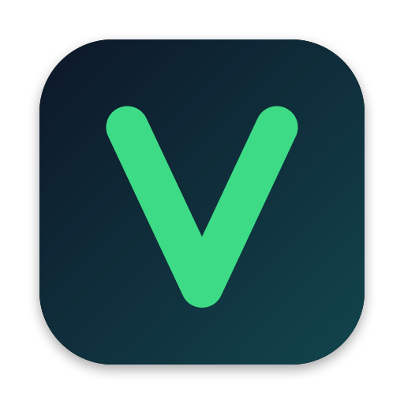
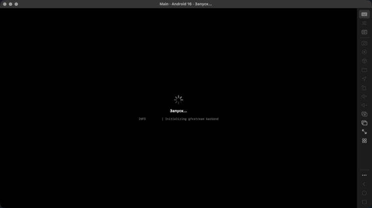
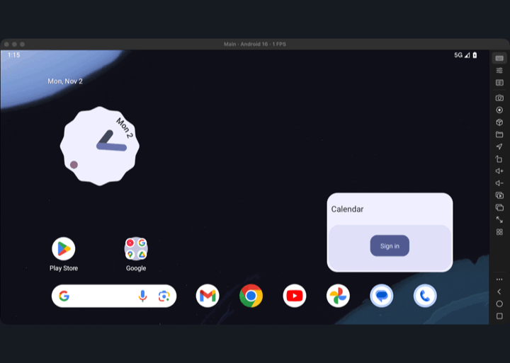
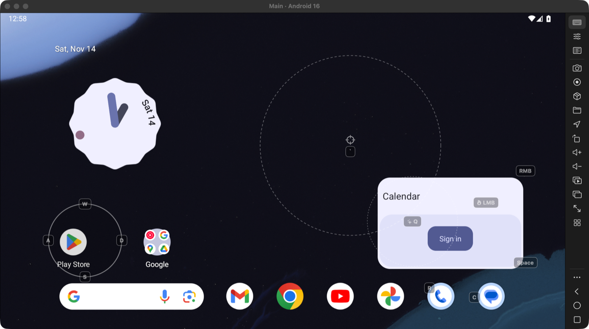
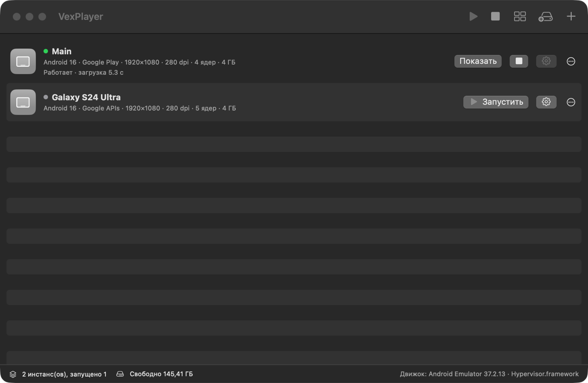
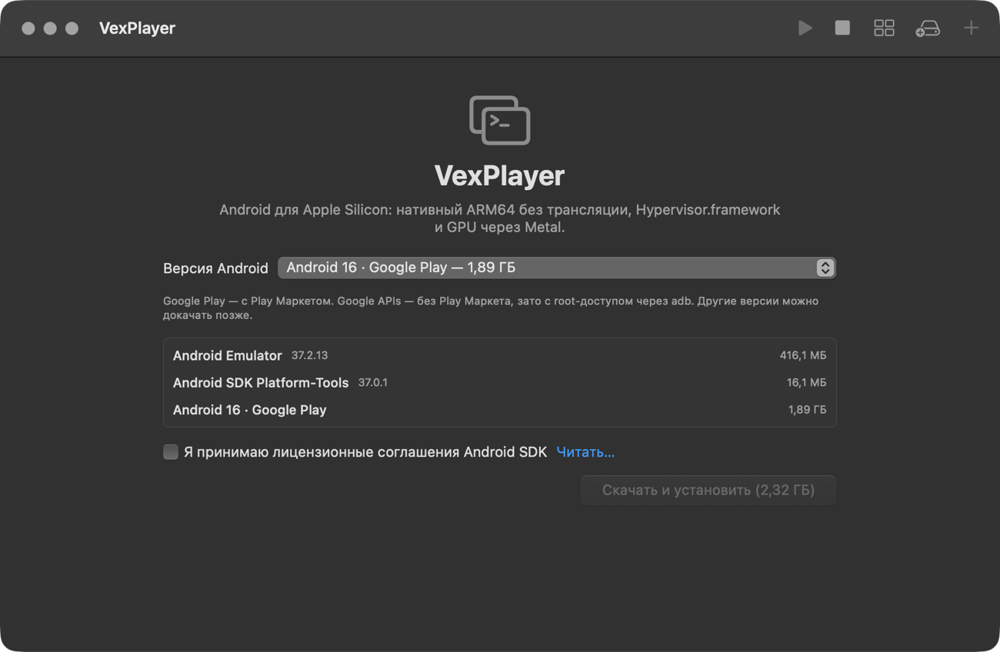
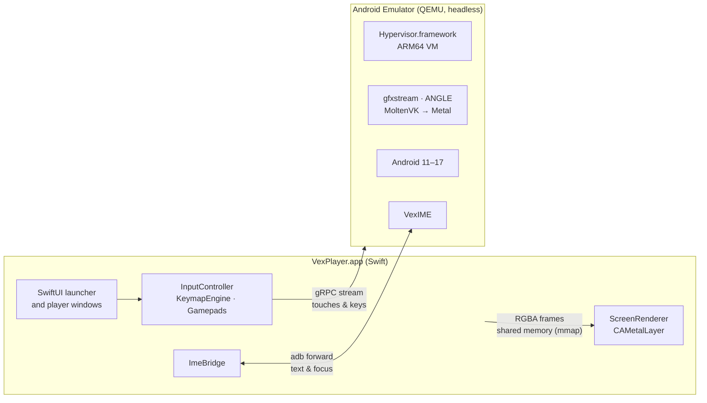

<div align="center">



# VexPlayer

**A free, native Android emulator for Apple Silicon Macs.**<br>
Modern Android (11–17), Metal graphics, key mapping for games, multi-instance, and typing in any language straight from your Mac keyboard.

[](LICENSE)


</div>

---

## Why VexPlayer?

Gaming emulators like MuMuPlayer made Android games feel at home on a desktop, but on the Mac they lag behind on Android versions and stay closed source. VexPlayer takes the same idea and builds it entirely from native pieces:

- **Native ARM64, no translation.** Android runs directly on the M-series cores through `Hypervisor.framework`. There is no x86 → ARM layer such as libhoudini in between.
- **Metal all the way down.** Guest OpenGL ES and Vulkan go through ANGLE → Vulkan → MoltenVK → Metal, and frames reach the screen through zero-copy shared memory.
- **A real Mac app.** SwiftUI, AppKit and Metal. No Electron, no Qt window, no web view.
- **Up-to-date Android.** Pick any official Google image from Android 11 to Android 17, with or without Google Play.
- **Free and open.** Apache 2.0. Fork it, ship your own build, make it better.

> [!NOTE]
> **Status: 0.1, early preview.** The full end-to-end test passes on a live Android 16 device (boot, frames, touch, keyboard, Cyrillic text, rotation, Quickboot). Expect rough edges. The interface is in English and Russian and follows your macOS language.

## Highlights

<table>
<tr>
<td width="50%" valign="top">

### ⚡ Boots in about 5 seconds

Quickboot saves the whole VM to a RAM snapshot when you stop an instance, so the next start skips the Android boot entirely.



</td>
<td width="50%" valign="top">

### 🔄 Follows the device orientation

When a game switches to landscape, the window rotates and resizes with it. Rotation is applied in the shader, with no extra copy.



</td>
</tr>
</table>

### 🎮 Key mapping built for games

Place controls right on top of the game, bind them to keys, mouse buttons or gamepad buttons, and play. Every game gets its own profile, and each profile can hold several control schemes.

<p align="center">

</p>

| Control | What it does |
|---|---|
| **Tap** | Holding the key holds a finger on that spot. |
| **Auto-tap** | Rapid repeated taps while the key is held; the interval is configurable. |
| **Joystick** | Four keys (WASD by default) or the left gamepad stick drive a virtual stick. |
| **Mouse look** | Locks the cursor; mouse movement becomes a finger dragging the camera. Re-centers automatically. |
| **Fire** | Left click while in mouse-look mode. |
| **Swipe** | One key performs a swipe from point A to point B. |
| **Skill** | MOBA-style smart cast: press to grab the skill, aim with the cursor, release to cast. |

### 🗂 Multi-instance

Run several Android devices side by side, each with its own CPU, RAM, resolution, Android version and device model. Clones are instant and take no extra disk space until they diverge, thanks to APFS copy-on-write.

<p align="center">

</p>

### 📦 One-click setup

On first launch VexPlayer downloads the official Android Emulator, platform-tools and the system image you choose directly from Google, checks every archive's SHA-1, and keeps everything in its own folder, separate from Android Studio.

<p align="center">

</p>

## Performance

Measured on a MacBook with an Apple M5 and 16 GB of RAM, running Android 16:

| Benchmark | VexPlayer | Stock emulator settings |
|---|---:|---:|
| First boot of a new instance | ~40 s | — |
| Start from a Quickboot snapshot | **~5 s** | — |
| Launcher scrolling, median frame time | **7 ms** | 17 ms |
| GPU time per frame, 90th percentile | **2 ms** | 21 ms |
| Janky frames | **2.7 %** | 10.9 % |
| Idle CPU, one instance on the home screen | **~7 %** of one core | — |
| Idle CPU, minimized with pause enabled | **< 0.5 %** | — |

Where the speed comes from:

- **ANGLE on Vulkan instead of the legacy OpenGL path.** The emulator's default macOS renderer sits on Apple's deprecated OpenGL 4.1 and gives Android GLES 3.0 only. VexPlayer turns on `GuestAngle`, so Android gets GLES 3.1 and rendering is about 2.5× faster. Android 15 and newer only: the ANGLE builds in older images don't run on MoltenVK (Android 13 boot-loops, Android 14 draws no text), so Android 11–14 stay on the OpenGL path with GLES 3.0.
- **Zero-copy frames.** The emulator writes each frame into shared memory, and a Metal texture points straight at those pages (`makeBuffer(bytesNoCopy:)`). Nothing is copied on the way to the screen.
- **A quiet idle.** The emulator's sensor HAL switches every virtual sensor on at boot and never off; once any app has read one at 50 Hz, the emulator keeps streaming all of them at 50 Hz with nobody listening. VexPlayer turns off the two system features that hold the accelerometer on an idle screen (flip-to-screen-off and the rotate suggestion button), and VexIME drops the stream back to 1 Hz after an app switch and once a minute. Idle CPU goes from ~25 % to ~7 %.
- **Events, not polling.** Rotation and the foreground app come from Android's event log the moment they change. Earlier builds asked `dumpsys` every 700 ms, which kept Android's system server busy around the clock.
- **No work for hidden windows.** When a player window is minimized or fully covered, frame streaming stops, the emulator stops reading frames back from the GPU, and it drops to background priority: macOS runs it on the efficiency cores and gives your other apps the performance cores first. Optionally, a minimized instance can be paused completely and resumes exactly where it was.
- **One input stream.** Touches and keys travel over a single long-lived gRPC stream instead of one RPC per event.
- **Performance cores by default.** The default vCPU count equals the number of P-cores, so the game thread never lands on an efficiency core.
- **Headless emulator.** No Qt window, no boot animation, no metrics, no virtual cameras. App Nap is disabled while an instance is running.
- **Guest-side composition** (`-HostComposition`) is both faster on the GPU and free of the banding artifacts the host compositor draws on blurred surfaces.

## Features

| Feature | Status |
|---|:---:|
| Android 11–17, Google Play or Google APIs images | ✅ |
| Lite edition of every image: no Google apps a game doesn't need, 1 GB less RAM; Minimal goes further, without Google Play services | ✅ |
| Multi-instance: create, clone, wipe, delete, batch start, tile windows in a grid | ✅ |
| Quickboot snapshots (~5 s start) | ✅ |
| Hidden instances on efficiency cores, optional pause when minimized | ✅ |
| Key mapping: tap, auto-tap, joystick, mouse look with cursor lock, fire, swipe, skill | ✅ |
| Per-game profiles (picked by the foreground app) with several schemes each | ✅ |
| Create, duplicate, rename, delete, export and import schemes | ✅ |
| Key mapping pauses itself while you type into a text field | ✅ |
| Gamepads (Xbox, PlayStation, MFi): buttons to controls, sticks to joystick and camera | ✅ |
| Typing in the Mac's current input language (Cyrillic, CJK, emoji, dead keys) | ✅ |
| Shared clipboard Mac ↔ Android, ⌘C / ⌘V / ⌘X / ⌘A / ⌘Z | ✅ |
| Install APK, XAPK and APKS by drag and drop | ✅ |
| Send files to Android (into `Download`) | ✅ |
| Screenshots (PNG + clipboard) and screen recording (hardware HEVC) | ✅ |
| Macro recording and playback, including loops | ✅ |
| Synchronizer: mirror input to every running instance | ✅ |
| Virtual location on a map | ✅ |
| Shake, rotate, volume, back / home / recents, fullscreen | ✅ |
| CPU, RAM, resolution, DPI, 60 / 90 / 120 Hz, GPU mode | ✅ |
| Device model profiles (Samsung, Xiaomi, OnePlus, ASUS ROG, Pixel) | ✅ Google APIs images |
| Root via `adb root` | ✅ Google APIs images |
| Interface in English and Russian | ✅ |
| Two-way shared folder Mac ↔ Android | ⏳ |
| Audio in screen recordings | ⏳ |
| Root on Google Play images | ⏳ |

## Getting started

**Requirements:** a Mac with Apple Silicon, macOS 15 or later, Xcode 16 or later (Swift 6), and about 3 GB of free disk space for the first Android image.

```bash
git clone https://github.com/xinitkey/vexplayer.git
cd vexplayer
scripts/build-app.sh
open build/VexPlayer.app
```

On first launch:

1. Choose an Android version. *Google Play* images include the Play Store; *Google APIs* images have no Play Store but allow root and device model profiles. Every image can also be created as a *Lite* or *Minimal* instance (see [Lite edition](#lite-edition) and [Minimal edition](#minimal-edition)).
2. Read and accept the Android SDK license. VexPlayer downloads about 2.3 GB from `dl.google.com`.
3. Click the play button next to the new instance. The first boot takes around 40 seconds; after that, Quickboot brings it back in about 5.

Everything VexPlayer downloads or creates lives in `~/Library/Application Support/VexPlayer`. It uses its own `adb` server port (5039), so it doesn't fight with Android Studio.

> [!TIP]
> You can start an instance straight from the terminal:
> ```bash
> build/VexPlayer.app/Contents/MacOS/VexPlayer --launch "Main"
> ```

## Using key mapping

1. Open a game and press **⌥E** to open the editor.
2. Pick a control type from the toolbar and click on the screen to place it. Drag it to move it; use the inspector to bind a key, mouse button or gamepad button and to adjust its radius, sensitivity or interval.
3. Click **Done** (or press Return). The scheme is saved automatically for this game. **Discard changes** closes the editor without saving.
4. Toggle key mapping at any time with **⌥K**.

The scheme menu in the editor and in the sidebar lets you keep several layouts per game, for example one for walking and one for driving, and switch between them in one click.

Schemes are plain JSON, so you can share them or write them by hand. Coordinates are fractions of the screen (0…1), and keys are macOS virtual key codes. Mouse buttons are `1001` (left), `1002` (right) and `1003` (middle).

```json
{
  "name": "Driving",
  "keymap": {
    "controls": [
      { "kind": "joystick", "x": 0.16, "y": 0.72, "keys": [13, 0, 1, 2], "radius": 0.065 },
      { "kind": "tap",      "x": 0.88, "y": 0.80, "key": 49 },
      { "kind": "repeatTap","x": 0.80, "y": 0.62, "key": 14, "intervalMS": 50 },
      { "kind": "swipe",    "x": 0.50, "y": 0.70, "x2": 0.50, "y2": 0.30, "key": 12 }
    ]
  }
}
```

Import it from the editor's scheme menu. Profiles are stored per app package in `~/Library/Application Support/VexPlayer/keymaps/`.

### Shortcuts

| Shortcut | Action |
|---|---|
| ⌥K | Toggle key mapping |
| ⌥E | Open the key mapping editor |
| ⌥S | Take a screenshot |
| ⌥R | Start or stop screen recording |
| ⌘V | Paste Mac clipboard text into Android |
| ⌘C · ⌘X · ⌘A · ⌘Z | Copy, cut, select all, undo inside Android |
| Return · Esc | Close the key mapping editor (changes are saved) |
| Delete | Remove the selected control in the editor |

## Typing in any language

Physical keys and text are handled differently, the same way they are on a phone with a hardware keyboard:

- **In a game**, keys go to Android as raw evdev key codes, so key mapping, WASD and shortcuts always work no matter which input source is active on the Mac.
- **In a text field**, keystrokes go through the macOS text input system first. Whatever input source you have selected (Russian, Ukrainian, Pinyin, Japanese, emoji picker, dead keys) is what you type, and switching it on the Mac takes effect immediately. The composed text is committed by **VexIME**, a tiny Android input method (`android/vexime`, about 13 KB) that VexPlayer installs and enables automatically.

VexIME also tells the Mac side when a text field gains focus, which is how key mapping knows to step aside while you type.

## Lite edition

Every installed image can be used as is or as its **Lite** edition, chosen when you create an instance. Lite is the same Google system image with the apps and background services a game never needs switched off on the first boot: the Google app and Assistant, Android System Intelligence, Photos, Messages, Gmail, Calendar, Phone, Clock, Maps, Drive, YouTube, Digital Wellbeing, accessibility and speech services, and a few more. The Play Store, Google Play services, Chrome, Gboard and Files stay.

| | Full | Lite |
|---|---:|---:|
| Memory used by Android itself (home screen, idle) | 1.9 GB | **1.4 GB** |
| Cached background apps | 0.9 GB | **0.2 GB** |
| Default RAM of the instance (16 GB Mac) | 4 GB | **3 GB** |
| Idle CPU | ~7 % | **~5 %** |

The default RAM matters more than it looks: Android fills spare RAM with file cache and never hands memory back to the Mac (the emulator's balloon device can't free it on macOS), and after a Quickboot restore the whole guest RAM is resident. So a 3 GB Lite instance uses about 1 GB less of your Mac's memory than a 4 GB one.

Activity Monitor shows an emulator at roughly twice its guest RAM (a 3 GB instance as ~6 GB). That is how macOS accounts for memory a Hypervisor.framework VM has mapped: the page-by-page total (`footprint <pid>`) is half of it, and idle guest memory is mostly compressed. Nothing is uninstalled: any app can be turned back on in Android's Settings → Apps.

## Minimal edition

**Minimal** goes further than Lite, for an instance that only needs to run a game and a browser. On top of everything Lite switches off, it disables Google Play services, the Play Store and Gboard, plus the system apps Android wakes at boot for features neither uses: work profile setup, IMS entitlement, the calendar provider, dynamic system updates, the backup transport, cell broadcasts, the print spooler, MMS, the live wallpaper picker, the storage manager and a few more. It also turns off Bluetooth, location, Wi-Fi and Bluetooth background scanning, the spell checker and backup; these are set only once, so you can turn them back on in Android's settings. VexIME takes Gboard's place as the keyboard.

Chrome and WebView, the package installer and Files stay, so games are installed from the browser as APKs. Apps that need Google services (the Play Store, Google sign-in, push notifications) won't work. Minimal is offered for Android 16 and newer: the Chrome in older images never gets past its first-run screen without Google Play services.

Measured on Android 16 Google APIs, idle, on the same Mac (Apple M5, 16 GB):

| | Lite | Minimal |
|---|---:|---:|
| Memory used by Android itself | 1.37 GB | **1.05 GB** |
| Emulator CPU (share of one Mac core) | 7.6 % | **5.7 %** |
| CPU used inside Android | 1.5 % | **1.1 %** |

Minimal instances get 2.5 GB of RAM by default on a 16 GB Mac: Android needs about 1.1 GB and a game typically 0.6–0.9 GB. Like Lite, Minimal is chosen when you create an instance: each image is offered as itself, as "… Lite" and as "… Minimal". It is never applied to an existing instance, and nothing is uninstalled: Android's Settings → Apps brings any app back.

## Device profiles

Out of the box, an emulator reports itself as `sdk_gphone64_arm64`. In the instance settings you can pick a real device instead:

`Galaxy S24 Ultra` · `Galaxy A55` · `Xiaomi 14` · `Redmi Note 13 Pro` · `OnePlus 12` · `ROG Phone 8` · `Pixel 8 Pro`

On the next start VexPlayer runs `adb root` and `adb remount`, rewrites the model, brand, device codename, board and build fingerprint in the `build.prop` of every partition, and reboots Android once. This works on Google APIs images; Google Play images have locked system partitions.

> [!IMPORTANT]
> Device profiles change what apps see in `android.os.Build`. VexPlayer does not spoof Play Integrity and does not try to defeat anti-cheat systems, and it won't.

## Architecture



| Layer | Folder | What's inside |
|---|---|---|
| SDK | `Sources/VexPlayer/SDK` | Parses Google's `repository2-3.xml`, downloads with resume, verifies SHA-1, unpacks |
| Instances | `Sources/VexPlayer/Instances` | AVD configs, APFS clones, device profiles |
| Engine | `Sources/VexPlayer/Engine` | Emulator process, gRPC client, adb, VexIME bridge, lifecycle |
| Display | `Sources/VexPlayer/Display` | mmap frame buffer → Metal texture → rotation shader, HEVC recorder |
| Input | `Sources/VexPlayer/Input` | Key mapping, evdev key codes, gamepads, macros, synchronizer |
| UI | `Sources/VexPlayer/UI` | Launcher, player window, key mapping editor, settings |
| gRPC API | `Sources/EmulatorAPI` | Code generated from `Protos/emulator_controller.proto` |
| VexIME | `android/vexime` | The Android input method and sensor-rate reset (plain Java, no Gradle) |

## Development

```bash
swift build                          # debug build
swift test                           # unit tests: geometry, key mapping, key codes, configs, live SDK catalog
VEX_E2E=1 swift test --filter E2E    # end-to-end test on a real emulator (downloads ~2.3 GB the first time)
scripts/build-app.sh                 # release .app bundle in build/
scripts/gen-proto.sh                 # regenerate the gRPC client from Protos/
```

To re-render the app icon after editing `scripts/make-icon.swift`:

```bash
swift scripts/make-icon.swift build/AppIcon.iconset
iconutil -c icns build/AppIcon.iconset -o Resources/AppIcon.icns
```

To rebuild VexIME you need a JDK 17+, Android build-tools and `android.jar`:

```bash
JAVA_HOME=/path/to/jdk BUILD_TOOLS=/path/to/build-tools/36.1.0 \
ANDROID_JAR=/path/to/platforms/android-36/android.jar scripts/build-ime.sh
```

The end-to-end test boots a real instance and checks frames, touch input, the hidden-window pause, the VexIME connection, typing Cyrillic text into the launcher search, rotation and a Quickboot restart.

## Limitations

- **ARM64 apps only.** That covers almost all of Google Play, which has required 64-bit ARM builds since 2019, but x86-only apps won't run.
- **Some anti-cheat systems detect emulators.** VexPlayer will not try to bypass them.
- **First keystroke in type-to-search lists.** Where Android starts a search from the first key press without a focused text field (for example the launcher's app list), that first letter is sent as a physical key and therefore uses Android's English layout. Everything after it goes through VexIME.
- **Android images are Google's.** They are distributed under the Android SDK license. VexPlayer never repackages them; it downloads them from Google after you accept the license.

## Roadmap

- More interface languages
- Signed and notarized DMG releases
- Two-way shared folder between the Mac and Android
- Audio in screen recordings
- Root on Google Play images

## Contributing

Issues and pull requests are welcome. Before opening a PR, please make sure `swift test` passes, and run the end-to-end test if you touched the engine, display or input code. Keep commits focused and write commit messages in English.

**Translations.** English is the development language: the strings in the source are the keys of `Resources/Localization/<language>.lproj/Localizable.strings`. `scripts/check-strings.sh ru` lists the strings that still need a Russian translation. To add a language, create its `.lproj` folder, add the code to `CFBundleLocalizations` in `Resources/Info.plist` and to `AppSettings.interfaceLanguages`, and run the script with the new code.

## License

VexPlayer is licensed under the [Apache License 2.0](LICENSE), the same license as the Android Emulator itself. You are free to use, modify and redistribute it, including in your own projects and forks. See [NOTICE](NOTICE) for third-party components.

VexPlayer is not affiliated with Google or with the makers of MuMuPlayer. Android is a trademark of Google LLC.
